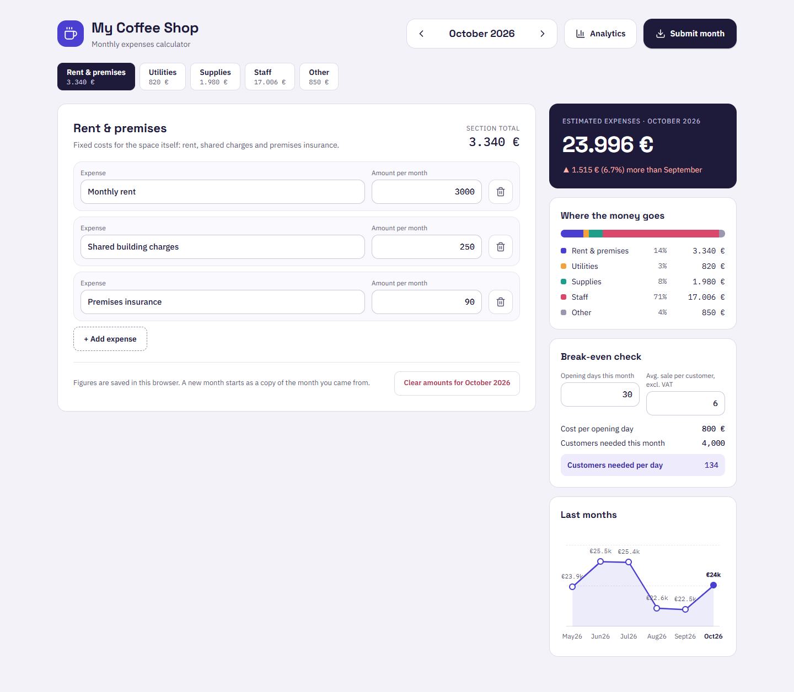
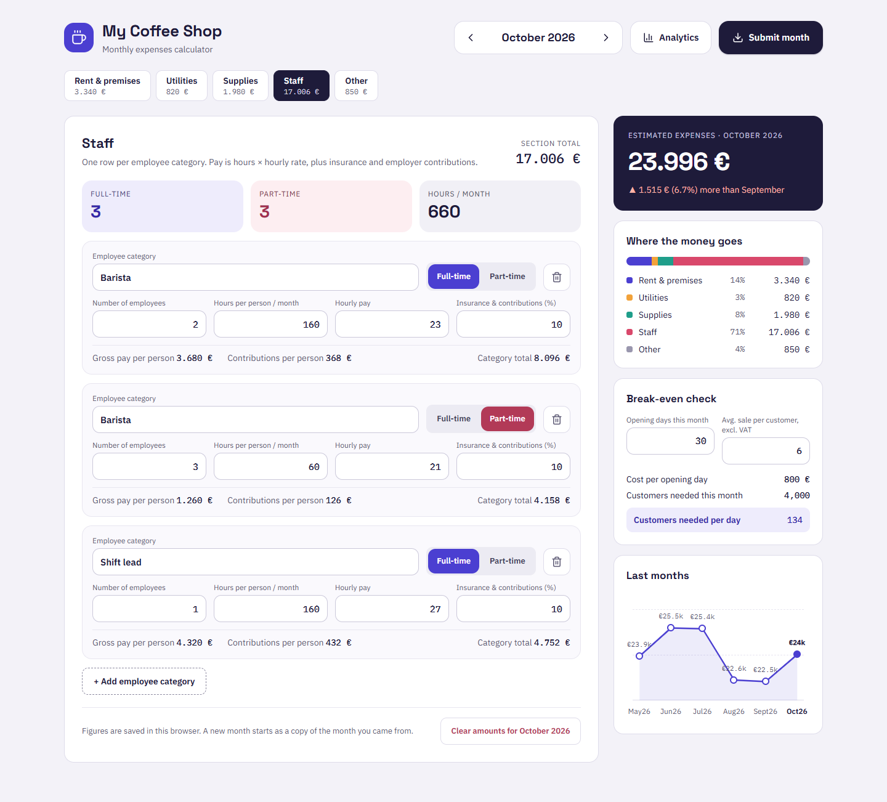
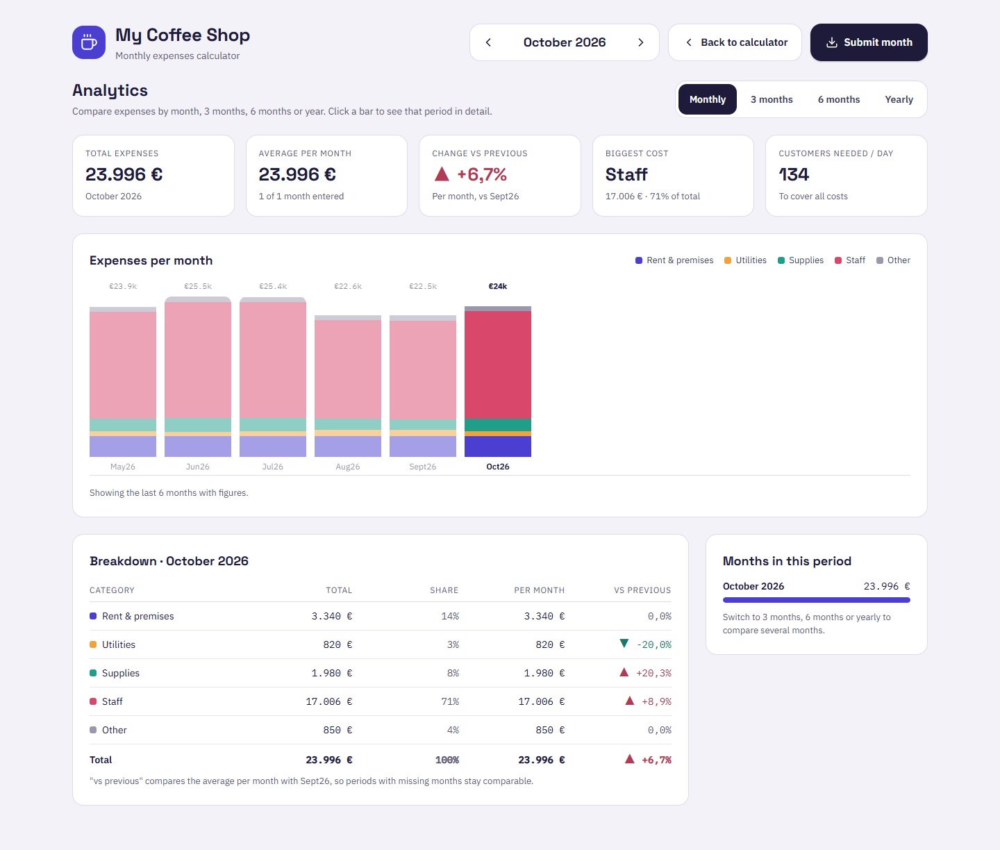

# ☕ My Coffee Shop — Monthly Expenses Calculator

A month-by-month expense calculator for a small coffee shop. Enter rent, utilities, supplies, staff and other costs, and see straight away what the month costs you, where the money goes, and how many customers you need each day to break even. Compare months, quarters, half-years and years, and export any month to an Excel workbook.



---

## Contents

- [Features](#features)
- [Screenshots](#screenshots)
- [Tech stack](#tech-stack)
- [Getting started](#getting-started)
- [Available scripts](#available-scripts)
- [Project structure](#project-structure)
- [How the numbers are calculated](#how-the-numbers-are-calculated)
- [Data & privacy](#data--privacy)
- [Configuration](#configuration)
- [Deploying to Netlify](#deploying-to-netlify)

---

## Features

**Calculator**

- **Five expense categories** with a tab each, showing a running total:
  - **Rent & premises**, **Utilities** and **Other**: free-form line items with a monthly amount.
  - **Supplies & consumables**: quantity (with a unit such as pcs, kg or L) × price per unit, with a line total.
  - **Staff**: one row per employee category (e.g. *Barista, part-time*). Pay = employees × hours × hourly rate, plus an insurance & contributions percentage. Summary tiles show full-time and part-time head count and total hours.
- **Estimated monthly total** compared with the previous month (▲ more / ▼ less, in amount and %).
- **Where the money goes**: a stacked bar and legend with each category's share.
- **Break-even check**: enter opening days and average sale per customer (excl. VAT) to get cost per opening day and the customers needed per month and per day.
- **Last months**: a line chart of up to six months ending at the selected month.
- **Month navigation**: step back and forward with the arrows. A month you haven't visited yet starts as a copy of the month you came from, so you only change what's different.
- **Clear amounts** for the current month while keeping the line items.

**Analytics**

- Group by **Monthly, 3 months, 6 months or Yearly**.
- KPI cards: total, average per month, change vs the previous period, biggest cost, and customers needed per day.
- Stacked bar chart of the last 12 periods. Click a bar to inspect that period.
- Breakdown table per category (total, share, per month, change vs previous) and a list of the months in the period.

**Export**

- **Submit month** downloads `My-Coffee-Shop-YYYY-MM.xlsx`, a real Excel workbook with four sheets: *Summary*, *Expenses*, *Staff* and *History*. Money cells are formatted as currency. The writer is built in, so no spreadsheet library is needed.

## Screenshots

| Staff costs | Analytics |
| --- | --- |
|  |  |

## Tech stack

| | |
| --- | --- |
| Framework | [Next.js 15](https://nextjs.org/) (App Router) + React 19 |
| Language | TypeScript (strict) |
| Styling | [Tailwind CSS 4](https://tailwindcss.com/), theme tokens in `src/app/globals.css` |
| UI primitives | [shadcn/ui](https://ui.shadcn.com/)-style components (`new-york` style) built on Radix Slot + `class-variance-authority` |
| Icons | [lucide-react](https://lucide.dev/) |
| Fonts | Space Grotesk (display), IBM Plex Sans (body), IBM Plex Mono (figures), via `next/font` |
| Persistence | Browser `localStorage`, no backend |

## Getting started

### Prerequisites

- **Node.js 20 or newer** (developed on Node 22). Check with `node -v`.
- **npm 10+** (comes with Node).

### 1. Install dependencies

From the project folder:

```bash
npm install
```

### 2. Run the development server

```bash
npm run dev
```

Open **http://localhost:3000** in your browser. The page reloads automatically when you edit the code.

To use another port:

```bash
npm run dev -- --port 3100
```

### 3. Production build (optional)

To check that everything compiles, then serve the optimized build locally:

```bash
npm run build
```

```bash
npm run start
```

`npm run build` also type-checks and lints the project and fails if anything is wrong. It's worth running before every deploy.

## Available scripts

| Command | What it does |
| --- | --- |
| `npm run dev` | Starts the dev server with hot reload on port 3000 |
| `npm run build` | Creates an optimized production build (includes type-check and lint) |
| `npm run start` | Serves the production build (run `build` first) |
| `npm run lint` | Runs ESLint with the Next.js rules |

## Project structure

```
coffee-shop-expenses/
├── docs/screenshots/            # Images used in this README
├── src/
│   ├── app/
│   │   ├── globals.css          # Tailwind setup + color/font theme tokens
│   │   ├── layout.tsx           # Root layout, fonts, page metadata
│   │   └── page.tsx             # Home route → <ExpensesApp />
│   ├── components/
│   │   ├── expenses/
│   │   │   ├── ExpensesApp.tsx  # Page shell: header, tabs, editor, sidebar, view switch
│   │   │   ├── AppHeader.tsx    # Logo, month switcher, Analytics + Submit buttons
│   │   │   ├── CategoryTabs.tsx # Category tabs with running totals
│   │   │   ├── Editors.tsx      # Line items, supplies and staff editors
│   │   │   ├── Sidebar.tsx      # Total, breakdown, break-even and history cards
│   │   │   └── AnalyticsView.tsx# Period grouping, KPIs, bar chart, breakdown table
│   │   └── ui/                  # Reusable primitives: Button, Input/Field, Card
│   ├── hooks/
│   │   └── useExpensesStore.ts  # Month data state + localStorage persistence
│   └── lib/
│       ├── expenses.ts          # Types, categories, sample data, all calculations
│       ├── xlsx.ts              # Dependency-free .xlsx writer + download helper
│       └── utils.ts             # cn() class-name helper
├── netlify.toml                 # Netlify build settings
└── package.json
```

## How the numbers are calculated

All calculations live in [`src/lib/expenses.ts`](src/lib/expenses.ts).

| Figure | Formula |
| --- | --- |
| Line item categories | sum of *amount per month* |
| Supplies | Σ quantity × price per unit |
| Staff (per category) | employees × hours × hourly pay × (1 + insurance % / 100) |
| Month total | premises + utilities + supplies + staff + other |
| Cost per opening day | month total ÷ opening days |
| Customers needed this month | ⌈ month total ÷ average sale ⌉ |
| Customers needed per day | ⌈ month total ÷ average sale ÷ opening days ⌉ |
| Analytics "vs previous" | change in **average per month** against the previous period, so periods with missing months stay comparable |

Number inputs accept either decimal separator (`1.5` or `1,5`).

## Data & privacy

- Everything is stored **only in your browser** (`localStorage`, key `my-coffee-shop-eur-v1`). Nothing is sent to a server.
- Data is per browser and per device. Clearing site data, or using a private window, starts fresh with the sample figures.
- To back up or share figures, use **Submit month**. The Excel file's *History* sheet holds every month you've entered.

## Configuration

| What | Where |
| --- | --- |
| Currency (`EUR`, `DKK`, `USD`, `GBP`) | `CURRENCY` in `src/lib/expenses.ts` |
| Brand / accent color | `--brand` (and related tokens) in `src/app/globals.css` |
| Category colors | `--chart-1` … `--chart-5` in `src/app/globals.css` |
| Category names and descriptions | `CATEGORIES` in `src/lib/expenses.ts` |
| Sample data for a first visit | `sampleMonth()` in `src/lib/expenses.ts` |

> **Note:** if you change the currency, also change `STORE_KEY` so amounts saved in one currency aren't shown as another.

## Deploying to Netlify

The repository includes a [`netlify.toml`](netlify.toml), so Netlify picks up the right settings automatically:

```toml
[build]
  command = "npm run build"
  publish = ".next"

[build.environment]
  NODE_VERSION = "22"

[[plugins]]
  package = "@netlify/plugin-nextjs"
```

### Option A: from a Git repository (recommended)

1. Push the project to GitHub, GitLab or Bitbucket.
2. In Netlify, choose **Add new site → Import an existing project** and pick the repository.
3. Netlify detects Next.js and reads `netlify.toml`. Leave the build command (`npm run build`) and publish directory (`.next`) as they are.
4. Click **Deploy**. Every push to the main branch redeploys the site, and pull requests get their own preview URLs.

### Option B: from the command line

```bash
npm install -g netlify-cli
```

```bash
netlify login
```

```bash
netlify init
```

```bash
netlify deploy --build --prod
```

`netlify init` links the folder to a new or existing site. Run `netlify deploy --build` without `--prod` first to get a draft URL to check.

### Notes

- No environment variables are needed. The app has no backend or secrets.
- Because data lives in each visitor's browser, every person (and every device) has their own separate figures.
- To use your own domain, go to **Site configuration → Domain management** in Netlify.
