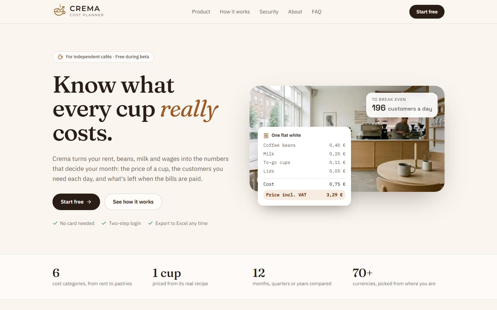
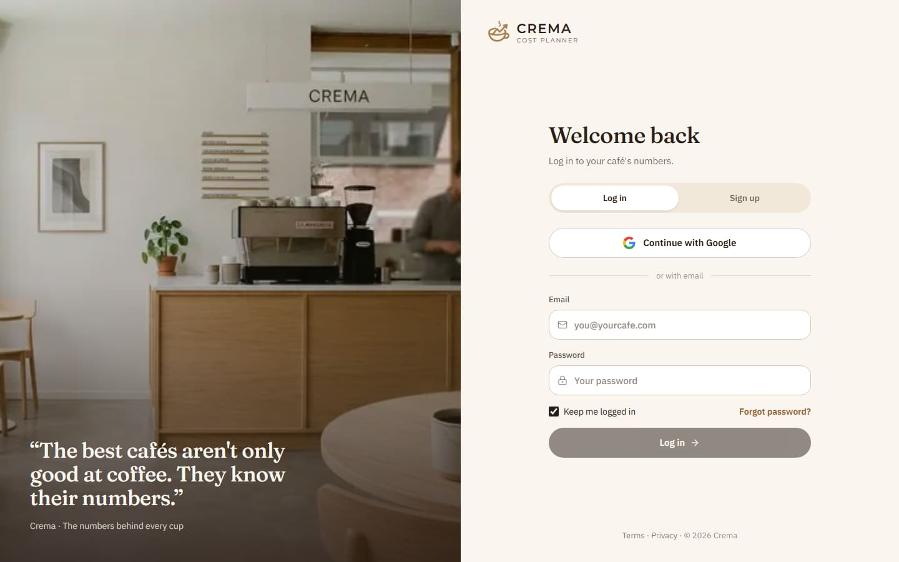
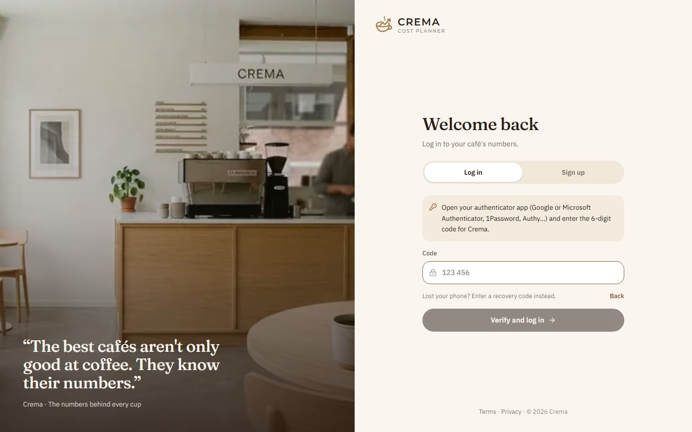
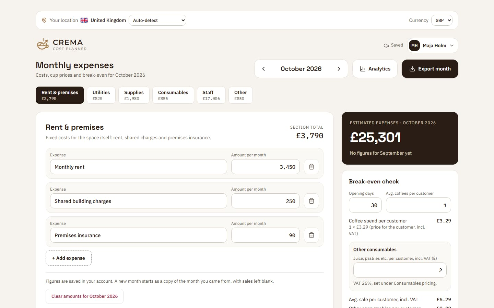
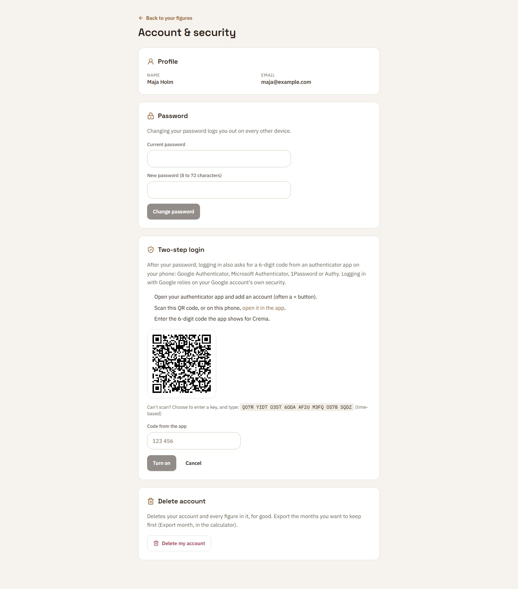

# Crema Cost Planner

**The numbers behind every cup.** Crema is the back office for independent cafés: monthly costs, the true cost and price of every cup, staff, break-even and profit, in one calm place. Each owner has an account (Google, or email and password with optional two-step login), and their figures follow them to any device.



---

## Contents

- [Features](#features)
- [Screenshots](#screenshots)
- [Tech stack](#tech-stack)
- [Getting started](#getting-started)
- [Scripts](#scripts)
- [Accounts and security](#accounts-and-security)
- [How figures are saved](#how-figures-are-saved)
- [Database migrations](#database-migrations)
- [How the numbers are calculated](#how-the-numbers-are-calculated)
- [Project structure](#project-structure)
- [Testing and CI](#testing-and-ci)
- [Deploying to Netlify](#deploying-to-netlify)
- [Before launch](#before-launch)

---

## Features

**Home page** (`/`): who Crema is and what it does, with the café photography. The figures shown on it (cup price, break-even, the month's total) are worked out by the app's own sums from its sample café, so the page never shows a number the product wouldn't.

**Accounts** (`/login`, `/app/account`)

- Sign up with Google, or with email and password (confirmed by an emailed link).
- **Two-step login**: a 6-digit code from an authenticator app (Google or Microsoft Authenticator, 1Password, Authy) after the password, set up with a QR code, with ten single-use recovery codes.
- Forgot password, change password (logs out every other device), delete account (with all its figures).

**Calculator** (`/app`)

Five views: **Expenses** (only costs), **Menu & sales** (prices, sales and break-even), **Daily takings**, **What if** and **Analytics**.

- **Expenses**: six cost categories, a tab each with a running total (Rent & premises, Utilities, Supplies, Consumables, Staff, Other), with the month's total, breakdown and history.
- **Supplier price history**: when a supply or consumable changes price, Crema saves the date and both prices, and shows an up or down arrow with the % change beside the price. Corrections on one day count as one change, and the history carries into new months. Right after a change, the row names the menu items it touches and their new margins, lowest first.
- **Months**: step back and forward; a new month starts as a copy of the one you came from, with sales and daily takings blank.
- **Menu & sales: drinks and food**: two lists, Drinks and Food, each with its own add button; an item added to the wrong one can be moved, or removed. Every item has its recipe (drinks from the Supplies and Consumables, food from the Consumables), menu price (VAT included), its VAT rate (each item's own: take-away and sit-in can be taxed differently; a new item starts at the menu's rate), and how many sell a month, ranked by what it earns. Cards for the best earner, the thinnest margin and the menu's total; per item, the price that reaches a target margin (one target for the whole menu, set from any item). A month saved before menus gets one drink from its old cup recipe and price.
- **Menu & sales: sales & profit**: the month's sales follow the menu (each item's price without VAT × how many sell) and update as it changes, until the actual takings are typed in; then the profit or loss, margin, and distance from break-even.
- **Menu & sales: break-even check**: customers needed per month and per day, from drinks and food per customer at the menu's average drink and food prices, each item's VAT taken out. Food per customer is worked out from what the menu sells (food items per drink) unless typed in. Also shows the till target per opening day, VAT included.
- **Daily takings**: a calendar of the month to type each day's till total into (VAT included), green or red against the daily target: the month's costs over its opening days, with the average VAT on a sale on top. Shows what's taken, what's needed, what each day left must take, the pace, the average by day of the week, and can set the month's sales from the takings without VAT.
- **What if**: sliders for bean and milk prices, rent, extra staff hours, drink prices and cups sold, plus one-tap scenarios, tried on the month's own figures without saving. Shows profit, costs, sales and break-even before and after, and what would keep today's profit: a price rise in %, or more customers a day.
- **Analytics**: group by month, 3 months, 6 months or year, with KPIs, a stacked bar chart and a breakdown table.
- **Export month**: a real Excel workbook (Summary, Expenses, Staff, Menu, Daily takings when there are any, History), from a built-in writer with no library.
- **Location and currency**: the visitor's country (from Netlify's IP geolocation, else the browser language) picks the currency, with a flag. Both can be changed by hand. 70+ currencies.

## Screenshots

| Log in | Two-step login |
| --- | --- |
|  |  |

| Calculator | Turning on two-step login |
| --- | --- |
|  |  |

## Tech stack

| | |
| --- | --- |
| Framework | [Next.js 15](https://nextjs.org/) (App Router, Server Components) + React 19 |
| Language | TypeScript (strict) |
| Styling | [Tailwind CSS 4](https://tailwindcss.com/); theme tokens in `src/app/globals.css` |
| UI | [shadcn/ui](https://ui.shadcn.com/)-style primitives, [lucide-react](https://lucide.dev/) icons |
| Fonts | Fraunces (headlines), Montserrat (wordmark), Space Grotesk (display), IBM Plex Sans and Mono, via `next/font` |
| Auth | [Auth.js v5](https://authjs.dev/) (Google + credentials), JWT sessions, bcrypt, TOTP (RFC 6238) |
| Database | MongoDB Atlas (official driver + Auth.js adapter) |
| Email | SMTP via Nodemailer |
| Tests | Vitest + Testing Library |
| Hosting | Netlify (`@netlify/plugin-nextjs`) |

## Getting started

Requires **Node.js 22** (`.nvmrc`).

```bash
npm install
npm run dev
```

Open **http://localhost:3000**.

**Two modes**, picked from the environment:

| | Local mode (default) | Accounts mode |
| --- | --- | --- |
| When | `MONGODB_URI` or `AUTH_SECRET` is blank | Both are set |
| Log in | None: `/app` opens straight away, `/login` redirects to it | Google, plus email + password with two-step login once emails can be sent |
| Figures | In this browser (`localStorage`) | In the owner's account, on every device |

Local mode means a fresh clone and CI work without any setup.

**For accounts**, copy [`.env.example`](.env.example) to `.env.local` and fill it in:

1. **MongoDB**: create a free Atlas cluster and a database user. Put the connection string in `MONGODB_URI`, ending with the database name (`…mongodb.net/crema`). Under Network Access, allow your IP address (and `0.0.0.0/0` for Netlify, whose functions have no fixed IPs).
2. **AUTH_SECRET**: `npx auth secret`. Keep it stable: it also encrypts two-step login secrets.
3. **Google** (optional): create an OAuth client in Google Cloud Console with the redirect URI `http://localhost:3000/api/auth/callback/google` (and your site's URL). Set `GOOGLE_CLIENT_ID` and `GOOGLE_CLIENT_SECRET`. Without them, the Google button isn't shown.
4. **Email** (optional): email + password log in needs emails (confirmation and reset links), so it's offered only when `EMAIL_SERVER_HOST` is set. Without it the site is Google-only, and a Google account deletes itself after a fresh Google log in instead of a password. With neither Google nor SMTP set, email log in stays on and development prints the emails to the `npm run dev` terminal.
5. Run `npm run db:migrate` once to create the indexes.

## Scripts

| Command | What it does |
| --- | --- |
| `npm run dev` | Development server on port 3000 |
| `npm run build` | Production build |
| `npm start` | Serve the production build |
| `npm run typecheck` | `tsc --noEmit` |
| `npm run lint` | ESLint (Next.js core-web-vitals and TypeScript rules) |
| `npm test` | All unit tests once |
| `npm run test:watch` | Re-run tests on change |
| `npm run db:migrate` | Run the database migrations against `MONGODB_URI` from `.env.local` |

## Accounts and security

Server code is in [`src/lib/server`](src/lib/server), guarded by `server-only`; the browser side is [`src/lib/auth-client.ts`](src/lib/auth-client.ts).

- **Joining** emails a confirmation link; the account only gets its password when the link is used. Joining again with an unconfirmed address replaces the pending password, and only the newest link works, so nobody can put their password on your address.
- **No account enumeration**: sign-up, resend and "forgot password" answer the same for every address, and "confirm your email first" is only said after the password matched. Unknown addresses take as long to check as wrong passwords.
- **Passwords**: bcrypt, cost 12, 8 to 72 characters (bcrypt reads 72 bytes).
- **Email links** are 32 random bytes; only their SHA-256 is stored. Confirmation links last 24 hours, reset links 1 hour, and each works once. Opening a link only shows a button, because mail scanners open links before people do.
- **Two-step login**: TOTP (HMAC-SHA1, 6 digits, 30 s, ±1 step), each code accepted once. The secret is encrypted with AES-256-GCM using a key derived from `AUTH_SECRET`. Recovery codes are stored as hashes, and using one emails the owner. Logging in with Google relies on Google's own security.
- **Sessions**: an httpOnly JWT cookie for 30 days, or 12 hours without "Keep me logged in". A password change or reset, or deleting the account, ends every older session.
- **Rate limits**: log in 10 tries per address and 30 per IP every 15 minutes; sign-up, resend, forgot and reset per IP per hour; account settings 10 password checks per 15 minutes. Account emails are throttled to one a minute per address. With Upstash Redis set (`UPSTASH_REDIS_REST_*`), every server instance shares the counts; otherwise each counts in its own memory.
- **Open redirects**: `/login?next=` only accepts paths on this site ([`next-path.ts`](src/lib/next-path.ts)).
- **Headers**: `X-Frame-Options`, `X-Content-Type-Options`, `Referrer-Policy`, `Strict-Transport-Security` and `Permissions-Policy` on every response ([`next.config.ts`](next.config.ts)).

## How figures are saved

A **workspace** ([`src/lib/workspace.ts`](src/lib/workspace.ts)) is everything one owner has entered: every month, the month they're on, the currency and the country.

- **Accounts mode**: [`GET/PUT /api/workspace`](src/app/api/workspace/route.ts) keeps one document per owner in `workspaces`. The browser saves 0.8 s after the last change, and the header shows *Saving… / Saved*.
- **Two devices**: every save names the version it was made from. One made from an older version (another device saved since) is refused with `409`, and the browser shows what's saved instead of overwriting it ("Updated from another device").
- **Checked on the server**: the server rebuilds every workspace from known fields only, with bounds on size (240 months, 200 items per list, 2 MB per save). The same function reads figures saved in a browser.
- **Moving in**: on a new account, figures this browser saved before accounts existed are offered for import, once.
- **Local mode**: as before, in `localStorage` (key `my-coffee-shop-eur-v1`, kept so earlier figures still load).

## Database migrations

Indexes are made by numbered migrations in [`scripts/migrate.mjs`](scripts/migrate.mjs), each run once per database and recorded in the `migrations` collection. The app never creates indexes itself, so a cold start doesn't wait for them.

- **Netlify** runs them before every production build (`netlify.toml`). Deploy previews and branch deploys skip them, so a branch never changes the production database before it's merged. If a migration fails, the build fails and the current version stays live.
- **By hand**: `npm run db:migrate`.
- **Changing an index or moving data**: add a new migration; never edit one that has run.

Collections: `users`, `accounts` and `sessions` (Auth.js), `workspaces`, `migrations`.

## How the numbers are calculated

The month's calculations live in [`src/lib/expenses.ts`](src/lib/expenses.ts), the menu's in [`menu.ts`](src/lib/menu.ts), the daily takings' in [`takings.ts`](src/lib/takings.ts) and the what-if's in [`what-if.ts`](src/lib/what-if.ts), each with its tests beside it.

| Figure | Formula |
| --- | --- |
| Line-item categories | sum of *amount per month* |
| Supplies, Consumables | Σ quantity × price per unit |
| Staff (per row) | employees × hours × hourly pay × (1 + contributions % / 100) |
| Month total | sum of the six categories |
| Average drink price | the menu prices weighted by cups sold, or their plain average without cups sold; with VAT, and without it at each drink's own rate |
| Food per customer | as typed, else food sold ÷ drinks sold × drinks per customer |
| Average sale, excl. VAT | drinks × average drink price without VAT + food × average food price without VAT |
| Till target per opening day | month total ÷ opening days × average sale incl. VAT ÷ excl. VAT |
| Customers needed per month / day | ⌈ month total ÷ average sale ⌉, then ÷ opening days |
| Sales | takings typed in, else Σ menu price ÷ (1 + the item's VAT) × number sold a month |
| Profit | sales (excl. VAT) − month total |
| Margin (Menu) | menu price ÷ (1 + the item's VAT, else the menu's for its kind) − Σ recipe amount × the supply's or consumable's price per unit |
| Price for the target margin | cost ÷ (1 − target %) × (1 + VAT) |
| Daily target (takings) | month total × (1 + average VAT on a sale) ÷ opening days, where average VAT = average sale incl. VAT ÷ excl. VAT − 1 |
| Needed per day from here | (needed − taken) ÷ opening days not yet entered |
| What if: costs | beans and milk Supplies × (1 + change), all Supplies and Consumables × (1 + cups sold change), Rent & premises × (1 + change), + extra hours × 52 ⁄ 12 × the staff's average hourly cost (part-timers' when there are any) |
| What if: sales | takings, or the menu's cups × price excl. VAT; × (1 + cups sold change), + cups × average drink price excl. VAT × price change |
| What if: keep today's profit | lost profit ÷ (cups × average drink price excl. VAT), rounded up to a whole %; or lost profit ÷ average sale ÷ opening days customers |

Typed amounts accept either number style: `1200.50`, `1,200.50`, `1 200,50`, `1.200,50` and `1,5`. A single separator followed by exactly three digits groups thousands (`1,200` is 1200), unless the whole part is 0 (`0.018` kg stays a fraction).

The break-even counts every cost as fixed. Supplies and consumables really grow with sales, so it's a little cautious (it slightly overstates the customers needed).

## Project structure

```
crema/
├── docs/screenshots/              README images
├── netlify/edge-functions/geo.ts  IP location on Netlify (/api/geo)
├── public/
│   ├── home/                      café photography, the menu board, the sign, the link-preview image
│   ├── brand/                     Google "G" for the sign-in button
│   └── flags/                     country flags for the location bar
├── scripts/migrate.mjs            database migrations (npm run db:migrate)
├── src/
│   ├── app/
│   │   ├── page.tsx               / → home page
│   │   ├── login/                 log in / sign up
│   │   ├── app/                   /app → calculator; /app/account → account & security
│   │   ├── verify-email/, reset-password/, auth/error/
│   │   ├── terms/, privacy/       drafts (see Before launch)
│   │   ├── icon.svg, apple-icon.png
│   │   └── api/
│   │       ├── auth/[...nextauth] Auth.js
│   │       ├── account/*          join, resend, forgot, reset, settings, password, two-step, delete
│   │       ├── workspace/         the owner's figures
│   │       └── geo/               IP location (local fallback for the edge function)
│   ├── components/
│   │   ├── home/                  home page, legal page frame
│   │   ├── auth/                  log-in panel, reset form, page frame
│   │   ├── account/               account & security
│   │   ├── expenses/              the calculator: Expenses, Menu, Daily takings, What if and Analytics views
│   │   ├── brand/                 the Crema mark and wordmark
│   │   └── ui/                    Button, Input, Card
│   ├── hooks/useExpensesStore.ts  figures: load, save, versions, import
│   ├── lib/
│   │   ├── expenses.ts            types, sample data, the month's calculations
│   │   ├── menu.ts                each drink's and food item's cost, margin and target price
│   │   ├── takings.ts             each day's till against the daily break-even target
│   │   ├── price-history.ts       each supply's past price changes
│   │   ├── price-impact.ts        which menu items a price change touches
│   │   ├── what-if.ts             a change tried on the month's figures
│   │   ├── workspace.ts           the saved shape and its checks
│   │   ├── geo.ts                 country → currency, location lookup
│   │   ├── xlsx.ts                dependency-free Excel writer
│   │   ├── auth-client.ts, workspace-client.ts   browser side of the API
│   │   └── server/                auth, accounts, TOTP, database, mailer, rate limits, config
│   └── types/next-auth.d.ts
├── .env.example                   every setting; copy to .env.local
└── netlify.toml                   build command (migrations, then build)
```

## Testing and CI

`npm test` runs the unit tests: every calculation and number format, workspace checks, redirects, migrations, and the account rules ported from a production auth system (joining, links, password reset, two-step login with recovery codes, rate limits).

GitHub Actions ([`.github/workflows/ci.yml`](.github/workflows/ci.yml)) runs typecheck, lint, tests and a production build on every pull request and push to `main`.

The full account flow (sign up, confirm the email, log in, save and reload figures, turn on two-step login, log in with a code, the version conflict, and the API refusing anonymous requests) was checked end to end against a real MongoDB and an SMTP catcher.

## Deploying to Netlify

`netlify.toml` sets the build command (migrations, then `next build`), Node 22 and the Next.js runtime.

1. Import the repository in Netlify (**Add new site → Import an existing project**).
2. Under **Site configuration → Environment variables**, add `MONGODB_URI`, `AUTH_SECRET`, `GOOGLE_CLIENT_ID` and `GOOGLE_CLIENT_SECRET`. Add `EMAIL_SERVER_HOST`, `EMAIL_SERVER_PORT`, `EMAIL_SERVER_USER`, `EMAIL_SERVER_PASSWORD` and `EMAIL_FROM` to offer email + password log in too.
3. Add `AUTH_URL` with **a value for the Production context only**: the site's address, e.g. `https://crema-cost-planner.netlify.app` (no trailing slash). Without it, Auth.js takes the host Netlify hands the function, `main--<your-site>.netlify.app`, and Google refuses the log in with `Error 400: redirect_uri_mismatch`. Leave the other contexts empty, or deploy previews would send Google logins back to the live site. Email links use `AUTH_URL` too, so `APP_URL` isn't needed.
4. In Google Cloud Console, add `https://<your-site>/api/auth/callback/google` as an authorized redirect URI.
5. Deploy. The production build log shows `Migrating: …` the first time, then `the database is up to date`.

Without `MONGODB_URI` and `AUTH_SECRET`, the deployed site runs in local mode (the build log warns).

**Moving to your own domain**: make it the primary domain in Netlify, change `AUTH_URL` to it, and add its `/api/auth/callback/google` address to the Google client's redirect URIs (keep the old one until the move is done).

## Before launch

- **Legal**: `/terms` and `/privacy` are drafts with `[bracketed]` placeholders (company name, address, contact, email provider, governing law). Have a lawyer finish them.
- **Contact**: there's no contact address on the site yet. Add one to the home page's About section and the legal pages.
- **Email**: an SMTP provider with your domain (SPF and DKIM set up), and `EMAIL_FROM` on that domain.
- **Logo**: `components/brand/Logo.tsx` and `src/app/icon.svg` are a hand-drawn vector of the sign. Replace them with the designer's master vector when there is one.
- **Region**: put the Atlas cluster in the same region as Netlify's functions (Site configuration → Functions → Region) to keep requests fast.
- **Rate limits**: add Upstash Redis so limits hold across every function instance.
